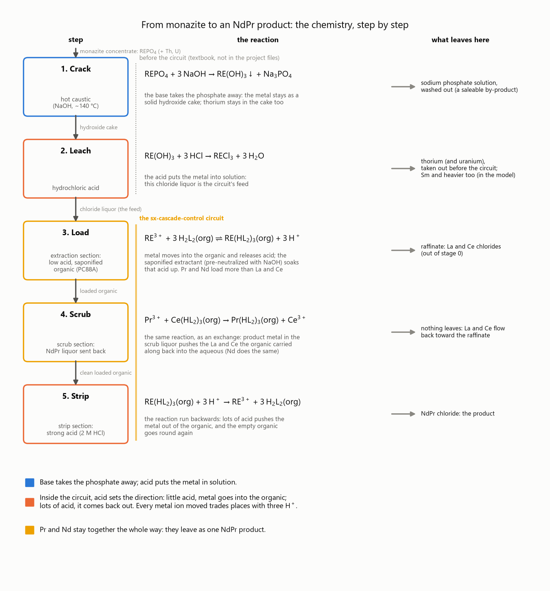
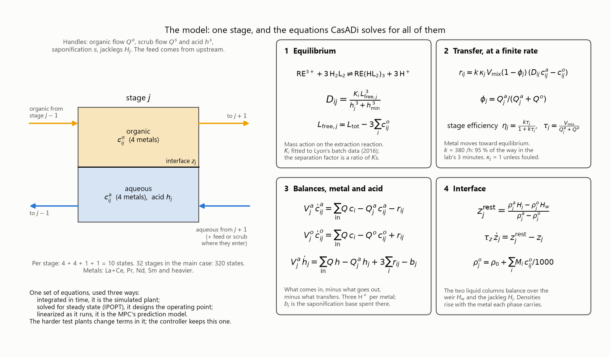
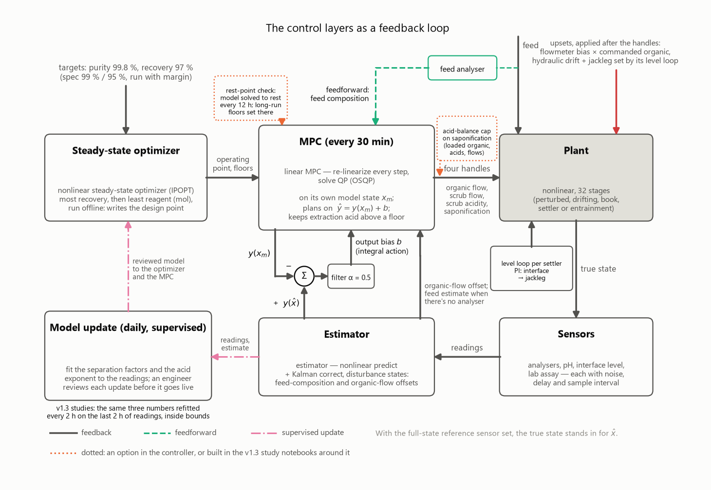
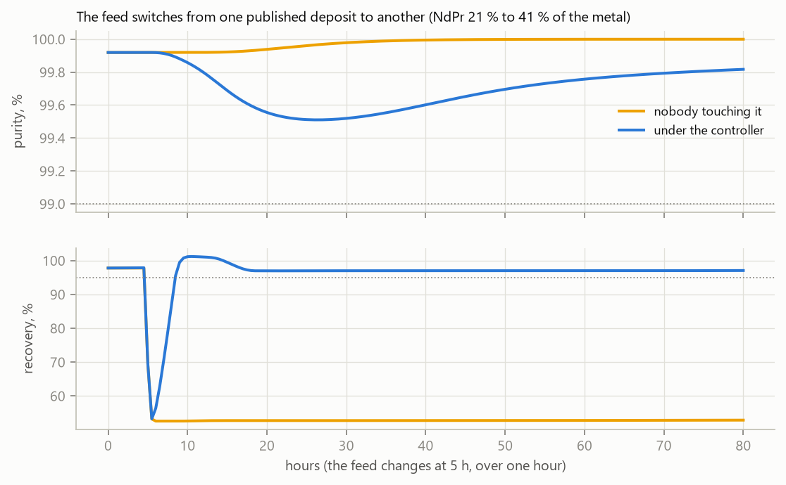
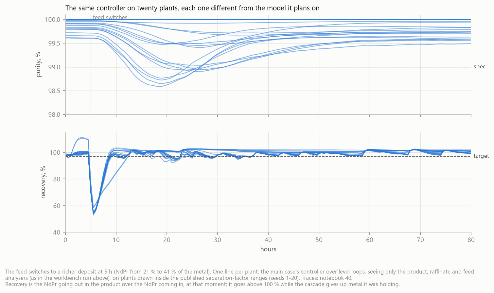
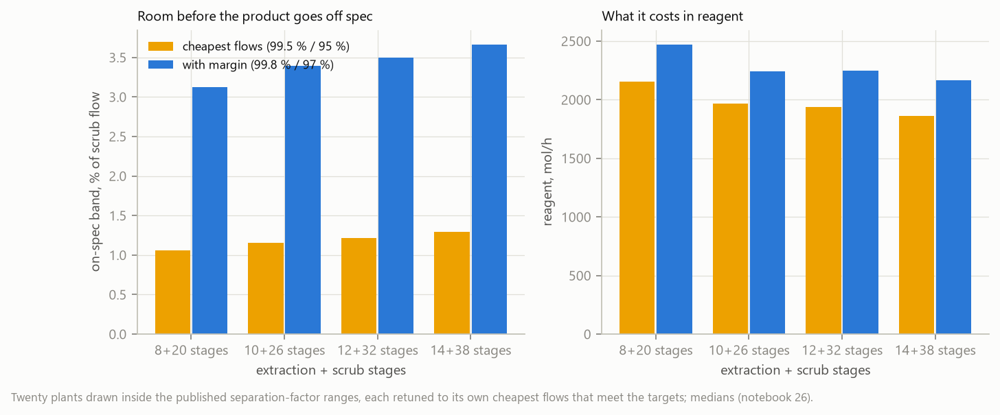
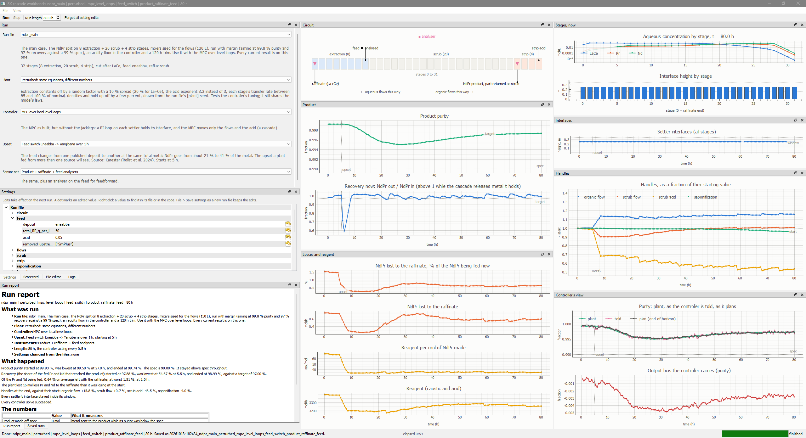

# Solvent extraction cascade: learning a process by building it

A rare earth solvent extraction circuit, built on a computer from the
chemistry and published data, and probed to see how it behaves: what it
needs, what upsets it, where it's sensitive, what a controller can and can't
do with it, and which measurements help. The work keeps a record of the
readings that didn't hold up and what replaced them.

This is a simulation. None of it is plant data, and it hasn't been checked
against a running circuit.

## At a glance

| Topic | Where it is in this project |
| --- | --- |
| Process modelling from the chemistry | The extraction reaction and its mass-action law, metal and acid balances in every stage, transfer at a finite rate, the settler interface from the two liquid columns; constants fitted to published batch data. In CasADi. The model figure below; [APPENDIX_A_model.md](APPENDIX_A_model.md) |
| Why the separation is hard | Purity goes as the flow ratio raised to the number of stages, so the window is a few percent wide; the plant is ill-conditioned like a high-purity distillation column. Checked against countercurrent theory and a 2018 textbook, and a harder test plant built from the book's relations. [FINDINGS_why_hard.md](FINDINGS_why_hard.md), notebooks 24, 29 |
| Optimization | Steady-state design with IPOPT: least reagent for a given purity and recovery; stage-count sweep; what operating margin costs and buys. `src/design.py`, notebooks 02, 04, 26 |
| Model predictive control | Linear MPC on a receding horizon, re-linearized on the nonlinear model as it runs, with purity, recovery and acidity constraints, over a PI level loop on each settler. Tested on 20 plants drawn inside published ranges, 8 upsets each. `src/mpc.py`, [APPENDIX_B_control.md](APPENDIX_B_control.md), notebook 14 |
| Sensors and state estimation | A Kalman filter on the instrument readings, with each instrument's calibration drift as a state. Which instruments, where, for what cost: on-line XRF at the ends, UV-Vis ratios inside the cascade, lab assays. `src/estimator.py`, notebooks 18, 31 |
| System identification, drift and faults | Separation factors and stage efficiency fitted to noisy readings; a daily refit follows a slow loss of separation; the trend of the fit flags a sudden fault. Notebooks 31, 32, 33 |
| Machine learning | A neural network (PyTorch) trained on simulated plants that reads the separation factors from the instruments: about 4 to 7 times closer than the physics fit on the main case, in a millisecond, and only as good as the plants it learned from. A PPO policy (stable-baselines3) compared with the MPC on the same episodes. Notebooks 35, 09 |
| Deployment and safety | The controller goes in steps (shadow, advisory, closed loop) inside move limits, with a watchdog and a journal; a feed-loss interlock; model updates checked, reviewed, versioned and reversible. `src/deployment.py`, `src/interlock.py`, `src/model_registry.py`, notebooks 34, 36, 37 |
| Plant integration | An optional way to run: the plant as an OPC UA server (asyncua) with tagged process values and setpoints, the controller as a client that sees only tags, and a small historian that records every tag in SQLite. A run over OPC UA gives exactly the same moves as the normal in-process run. `src/plant_server.py`, `src/historian.py`, notebook 38 |
| Software | A desktop workbench to set up, run, watch and compare runs, with a report of each run and session logs; settings saved as run files; every number in the parameter file states its source; 388 automated tests, including a check against reference runs to the last bit. `workbench/`, `params/`, `tests/` |

## The process



A monazite concentrate is cracked with caustic and leached with hydrochloric
acid. The chloride liquor that comes out carries the rare earths together.
The separation circuit splits it: lanthanum and cerium one way,
praseodymium and neodymium (NdPr, the magnet metals) the other.


The circuit is a long row of mixer-settlers. An organic liquid with an
acidic extractant (P507, also sold as PC88A) runs one way, the water phase
the other. In each stage Pr and Nd go into the organic a little more readily
than La and Ce, about twice as much. Repeated over thirty or forty stages,
that small preference gives a 99.5 % pure product. The extraction section
loads the organic, the scrub section washes the La and Ce back out of it with
some of the product sent back, and the strip section takes the NdPr off with
strong acid.

The feed is the published assay of the Eneabba monazite (Rollat, Bertuol and
Lévêque, 2024), the leaner of the two published feeds used here: about a fifth
of its rare earth oxide is Pr and Nd, so the scrub has about three times as
much La and Ce to wash back per unit of product.


Each stage is a mixer, where the metal moves between the two liquids and acid
is released, and a settler, where they separate again. The interface between
them is held by the height of the aqueous outlet, the jackleg.

More detail: the chemistry, the stage and the interface in [Appendix A](APPENDIX_A_model.md#a3-chemistry), sections A.3 to A.8.

## Background reading

The model and the reasoning behind it draw on these sources.

- D. Qi, *Hydrometallurgy of Rare Earths: Extraction and Separation*,
  Elsevier, 2018. Extractants, countercurrent extraction theory (Xu
  Guangxian's school), process design and equipment.
- K. L. Lyon, *Separation of Adjacent Rare Earth Elements Using Solvent
  Extraction*, MSc thesis, University of Idaho, 2016, and his PhD
  dissertation (Idaho, 2020). Nd and Pr equilibria, stage size, the lab rig.
- Rollat, Bertuol, Lévêque (Carester), *Improvements in Rare Earth
  Separation*, COM 2024. Feed compositions by deposit and the problems of a
  plant fed from several sources.
- Cheng, Wu, Liao, Yan, *Adjacent stage impurity ratio in rare earth
  countercurrent extraction process*, J. Rare Earths 31 (2013), and Cheng et
  al., J. Rare Earths 32 (2014) on minimum solvent amounts.
- Yang, Xu, Lu, Ding, *Component content distribution profile control in rare
  earth countercurrent extraction process*, Chin. J. Chem. Eng. 23 (2015), and
  the same group's patent, US 11,214,850 B2 (2022).
- Yin et al., Hydrometallurgy 175 (2018): industrial separation factors.
- Gupta and Krishnamurthy, *Extractive metallurgy of rare earths*, Int.
  Mater. Rev. 37 (1992).
- S. Skogestad, *Dynamics and control of distillation columns: a tutorial
  introduction*, Trans IChemE 75 (1997), and Skogestad, Morari, Doyle,
  *Robust control of ill-conditioned plants: high-purity distillation*, IEEE
  TAC 33 (1988). Distillation is the closest well-studied relative of this
  process from the control side.
- Z. Wu, P. D. Christofides et al., *A tutorial review of machine
  learning-based model predictive control methods*, Rev. Chem. Eng. 41(4)
  (2025) 359-400, doi 10.1515/revce-2024-0055.

## Approach

**A model from the chemistry.** Each stage is a mass balance per element and
per phase, with the metal moving toward equilibrium at a finite rate. The
equilibrium is the ion-exchange law of an acidic extractant: every metal ion
that goes into the organic releases three protons, so acid is tracked in
every stage and saponifying the organic is a handle. Constants are fitted
from the Idaho tables or taken from published ranges, and every number in the
parameter file states where it came from ([APPENDIX_A_model.md](APPENDIX_A_model.md),
[APPENDIX_A_parameters.md](APPENDIX_A_parameters.md)).



*Ten states per stage, 320 for the main case's 32 stages. The equations are
written once, in CasADi, and used as the simulated plant, by the design
optimizer and, linearized, by the controller.*

**Design, then size.** An optimizer finds the operating point of any circuit
size on the same equations, and a sweep over stage counts shows how many
stages the split needs.

More detail: the optimizer in [Appendix B, B.1](APPENDIX_B_control.md#b1-steady-state-operating-point-srcdesignpy); the stage counts in [REPORT.md section 3](REPORT.md#3-how-many-stages); the design with margin in [FINDINGS, phase 2](FINDINGS_why_hard.md#phase-2-2026-10-17-design-operating-margin-and-the-sized-plant).

**Probe it.** The usual upsets are run through it one at a time: a change of
feed between two published deposits, a stronger feed, more acid in the feed,
the feed pump stopping, a flowmeter reading low, a settler level drifting, the
scrub acid too strong, two tired mixers.

More detail: [REPORT.md section 4](REPORT.md#4-what-the-upsets-do).

**Never trust one plant.** The controller never drives its own model. It
drives plants that differ from it: twenty copies with their separation
factors drawn inside the published ranges, and plants with mechanisms the
model leaves out (settlers the liquid flows through, droplets carried into the
next stage, chemistry that drifts over days).

More detail: [Appendix A, A.12](APPENDIX_A_model.md#a12-plants-with-physics-the-model-doesnt-have), [Appendix B, B.8](APPENDIX_B_control.md#b8-the-plant-the-controller-drives-srcmismatchpy), [REPORT.md section 5.3](REPORT.md#53-twenty-plants-not-one).

**A controller on top, the way plants are built.** A level loop on each
settler, and a model predictive controller above them moving the organic
flow, the scrub flow and acid, and the saponification, to hold purity and
recovery.



*The main case: a level loop on each settler holds the interfaces, and the MPC
above it moves the organic flow, the scrub flow and acid, and the
saponification. The jacklegs could also be MPC handles, as in the first version;
local loops hold the interfaces tighter (ARCHITECTURE.md decision 32). On the
left, the slowest layer: the model's numbers refitted to the plant's readings,
reviewed before they're used.*

More detail: the MPC as equations in [Appendix B, B.2 and B.3](APPENDIX_B_control.md#b2-model-state-output-bias-linearization-and-prediction-srcmpcpy); why the plant is hard for it in [FINDINGS section 4](FINDINGS_why_hard.md#4-why-a-model-based-controller-struggles-ill-conditioning); the level loops in [ARCHITECTURE.md](ARCHITECTURE.md), decision 32.

**Sensors as data.** What each instrument reads, how noisy, how late, how
often, and an estimator that puts the readings together. Then which
instruments, where, are worth having. X-ray fluorescence on the feed, the
product and the raffinate reads every element on an absolute scale, and the
metal balance between the three checks them against each other. Inside the
cascade, Pr and Nd absorb visible light and La and Ce don't, so a plain optical
spectrometer read as ratios, stage against stage and Nd against Pr, sees the
profile with its calibration error cancelled. Those points go where the profile
moves most: the front between La and Ce and the NdPr, in the middle of the
scrub.

More detail: the sensors and the estimator in [Appendix B, B.4 to B.7](APPENDIX_B_control.md#b4-sensors-srcsensorspy); where the instruments go in [FINDINGS, phase 5](FINDINGS_why_hard.md#phase-5-2026-10-18-from-a-simulation-toward-a-plant).

**Learn the plant, under supervision.** A model is only as good as its numbers,
and a plant's numbers change. The slowest layer fits a few of them, the
separation factors and how close stages get to equilibrium, to what the
instruments read, once a day. The fit is a proposal: an engineer looks at it
before the controller uses it. Letting the model learn on its own in
production would let one bad reading, a fouled probe or a fault get built into
it, and the controller would then act on that. The same daily fit, watched over
time, also tells a slow drift from a sudden fault.

More detail: [FINDINGS, phases 3 and 4](FINDINGS_why_hard.md#phases-3-and-4-2026-10-17-a-plant-closer-to-the-book-and-identify-then-control) (identify, then control), [phase 5](FINDINGS_why_hard.md#phase-5-2026-10-18-from-a-simulation-toward-a-plant) (supervised updates, the learned estimator).

**Onto a plant in steps.** A controller goes on a plant in stages: shadow first (it
reads the plant and says what it would do, nothing more), then advisory (an
operator applies its advice), then closed loop. In every step there are limits
on how far each handle can move, a watchdog that holds the handles if the
controller fails, and a journal of every move. The limits come from the upsets
the plant really sees. The controller talks to the plant the way it would on
site, as an OPC UA client reading tags and writing setpoints, with a historian
recording every tag.

More detail: [FINDINGS, phase 5](FINDINGS_why_hard.md#phase-5-2026-10-18-from-a-simulation-toward-a-plant); [ARCHITECTURE.md](ARCHITECTURE.md), decisions 37 and 40.

**Go back when a reading is wrong.** Several first readings didn't survive a
closer look, and the documents keep the record. Five plants first taken as
uncontrollable turned out to come from separation factors drawn outside the
published ranges. A model gain that looked fifteen times off was a comparison
at two different operating points. And the controller kept losing some
plants because it could saponify the organic until the extraction stages ran
out of acid, a region the chemistry model doesn't cover and a real plant would
avoid. Each is written up with what replaced it.

More detail: the corrections in [REPORT.md section 5.3](REPORT.md#53-twenty-plants-not-one) and [FINDINGS](FINDINGS_why_hard.md#the-short-version).

## Results, in brief

Behind them: about two thousand closed-loop runs, over a hundred thousand
hours of simulated plant operation in all, across about sixty different
plants (copies drawn inside the published ranges, plus the plants with extra
mechanisms), eight upsets, several controllers and sensor sets. Add to that
tens of thousands of steady-state solutions for the design and measurement
studies and a few hundred optimized designs. Every number quoted in the
documents is checked automatically against the result tables.



One upset over time: the feed switches between two published deposits and
the NdPr in it doubles. With nobody touching it, the organic can't carry the
extra NdPr and about half of it goes out with the raffinate for as long as
nothing changes. The controller raises the organic flow and has recovery back
within hours, letting purity dip a little while staying above spec.



The same comparison on twenty plants drawn inside the published ranges,
eight upsets each, 80 hours per run. The controller helps most with changes
in the feed and the acids. The feed pump stopping is the upset it handles
worst; with an interlock it does as well as leaving the plant alone.



Running a little above the targets gives the plant about three times more
room before an upset takes the product off spec, for a modest amount of extra
reagent, and more stages make that margin cheaper.

More detail: [FINDINGS, phase 6](FINDINGS_why_hard.md#phase-6-2026-10-18-the-identification-line-on-the-main-case-and-the-reruns) (the interlock against doing nothing, on twenty plants), [phase 2](FINDINGS_why_hard.md#phase-2-2026-10-17-design-operating-margin-and-the-sized-plant) (margin).

## What the model shows

These are properties of the simulated plant. A real plant will have its own.

- The purity of the product depends on the balance between the organic flow
  and the scrub flow raised to the power of the number of stages. At the
  cheapest flows that meet the targets, the band that keeps the product on
  spec is about 1 % wide. Distillation has the same property, and the
  countercurrent extraction theory in Qi's book explains it.
- That's why such plants run with margin. Aiming a little above the targets
  made the band about 3 times wider in the model, for about 15 % more reagent,
  and more stages make that margin cheaper. The Chinese design method puts
  the scrub well above its minimum on purpose.
- Stages need time. With mixers too small for the flow, how close each stage
  got to equilibrium became a large unknown, and that unknown was much of what
  made some plants hard to control.
- The acidity in the extraction section has to be watched. Over-saponifying
  pushes it out of the range where the extraction works as intended.
- A controller is only as good as what it knows about the plant. With the
  true plant model the controller coped with every plant it was given; with a
  model a little off, it sometimes moved the wrong way. That points at
  measuring the plant better, and at estimating its numbers while it runs,
  more than at a cleverer controller.
- Where an instrument sits makes a big difference. At the front in the middle of
  the scrub, a 1 % change in the separation factor moves the Pr concentration by
  about 95 %; anywhere in the extraction section, by 4 % or less.
- The direction of a feed change decides the risk. Going to a richer feed, the
  plant left alone loses NdPr to the raffinate. Going to a leaner one, the
  organic is suddenly too much and pulls La and Ce into the product: 14 of 20
  plants went off spec with nobody acting, none with the controller.
- Learning the plant's numbers from its readings works, within limits. The
  physics fit comes out biased when the plant differs from the model in more
  ways than it fits; a neural network trained on simulated plants reads them
  more closely but misses at the edge of what it was trained on. On the plant
  run with margin, refitting daily mostly lets it run on less organic (about
  6 % less), and a safety ceiling on the handles has to be sized from the
  upsets: at 20 % it put 7 of 20 plants off spec on the feed switch; at 50 %
  the result was close to having no ceiling at all.

More detail: [FINDINGS_why_hard.md](FINDINGS_why_hard.md#the-short-version).

## Approaching a real plant

A model like this one is a way to learn, not a recipe. On a real plant the
work starts with what's already there: how the plant is built and run, what
it measures, and why its control system is the way it is. Any change worth
proposing then comes from that understanding rather than from hope. Which
changes would be worth it depends on things only the plant can say: reagent
costs, the cost of another stage or instrument, how tight the purity and
recovery requirements are, and which upsets the plant actually sees. The
model helps by being checked against the plant, used to explain what the plant
does, and only then used to look for improvements, in the measurements, in how
the data is handled, or in the control.

## The code and how to run it



- `src/`: the model (CasADi), the design optimizer, the plants, the
  controller, the estimator and sensors, and the run machinery.
- `workbench/`: a desktop app to choose a plant, controller, upset and sensor
  set, edit any setting, run, watch the circuit respond, and read a report of
  each run.
- `notebooks/`: the numbered studies behind every result.
- The documents, listed below.

Everything runs from this folder through pixi, which installs the environment
the first time:

```text
pixi run workbench                                  # the GUI (or double-click sx_workbench.bat)
pixi run python -m workbench --config ndpr_main     # the GUI on the main case
pixi run python -m src.cli list                     # what can be chosen
pixi run python -m src.cli run --config ndpr_main --plant perturbed --controller mpc_level_loops --upset feed_switch --hours 80
PYTEST_DISABLE_PLUGIN_AUTOLOAD=1 pixi run python -m pytest tests
```

## The documents

| Document | What's in it | How current |
| --- | --- | --- |
| [FINDINGS_why_hard.md](FINDINGS_why_hard.md) | Why the separation is sensitive, with the literature | Current |
| [APPENDIX_A_model.md](APPENDIX_A_model.md) | The model: assumptions, equations, what an SX engineer would question | Equations current. Worked numbers are for the first 30 L plant, not the main case (note at the top) |
| [APPENDIX_A_parameters.md](APPENDIX_A_parameters.md) | Every number in the parameter file, with where it came from | Current. The main case's own settings are in `configs/ndpr_main.toml` |
| [APPENDIX_B_control.md](APPENDIX_B_control.md) | The design optimizer, the MPC, the estimator, as equations | Current for what it covers. The later pieces (level loops, acidity floor, interlock, guard) are in ARCHITECTURE.md (note at the top) |
| [ARCHITECTURE.md](ARCHITECTURE.md) | How the code is put together, and every design decision with its reason | Current |
| [PROGRESS.md](PROGRESS.md) | The build log, newest first | Current |
| [REPORT.md](REPORT.md) | The full write-up of the first version | First version, kept as the record. Corrections are marked where later work replaced it |

## Limits

- It's a simulation from public data. The plants it's tested on differ from
  the model by chosen amounts, inside published ranges where there are any.
- The La+Ce extraction constant, the densities, the stage transfer rate and the
  instrument noise are chosen, not measured.
- The feed pump stopping was the upset the controller handled worst. A
  feed-loss interlock that freezes the handles brings it level with leaving
  the plant alone over the same 80 hours (notebook 34): for a pump stop, the
  best a controller can do is stay out of the way.
- The OPC UA link runs without encryption or certificates; a plant would
  require both.
