# A rare earth separation circuit, built and controlled on a computer

Emilio Heredia — October 2026

I built a working model of a solvent extraction circuit that takes a
monazite leach liquor and separates out NdPr, the neodymium–praseodymium
product that goes to magnet makers, from the lanthanum and cerium that
come with it. Then I found out how many stages such a circuit needs, ran
the upsets a plant sees through it, put a model predictive controller on
it, and asked which sensors and which handles are worth having. This
report is what came out, with the figures. Two appendices hold the
working: the model's assumptions, equations and every parameter with its
origin (A), and the optimizer, controller and estimator as equations (B).

Everything is my own simulation from published data. No number here comes
from any plant. Where a number was chosen by me instead of taken from a
source, it says so. The circuit is of the same kind as a real one and
nothing more: public chemistry, a published feed, a published stage count
for scale.

**Read this first (October 17).** Sections 3 to 8 are the first version of this
work, on a plant whose mixers were scaled from the lab rig and ran at 81 to 85 %
of equilibrium. Later work changed the main case and some conclusions. The
main case is now `configs/ndpr_main.toml`: mixers sized to the flow (stages at
about 95 %), run with margin (aiming at 99.8 % purity and 97 % recovery instead
of 99.5 % and 95 %), with an acidity floor in the controller and a level loop on
each settler under it. On twenty plants drawn inside the published ranges it
keeps every one on spec through the feed and acid upsets. `README.md` has those
results and `FINDINGS_why_hard.md` has why the split is hard and what the design
and the literature say about it. Section 5.3 is corrected in place; the rest of
sections 3 to 8 stays as it was, as the record of the first plant.

## 1. What the circuit is

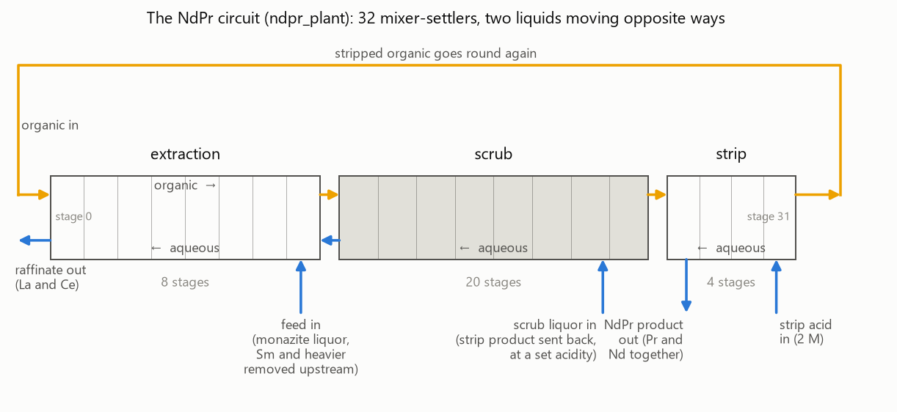

Thirty-two mixer-settlers in a row (eight extraction, twenty scrub, four
strip). The organic — the extractant PC88A in kerosene — enters at one
end and runs through all of them; the aqueous runs the other way. The
feed, a monazite liquor that is about two thirds lanthanum and cerium and
one fifth NdPr, comes in where the extraction section meets the scrub
section. The heavier rare earths prefer the organic: praseodymium about
twice as much as cerium, neodymium a little more again. That preference,
repeated stage after stage, is what puts a 99.5 % NdPr product out of one
end and a lanthanum–cerium raffinate out of the other.

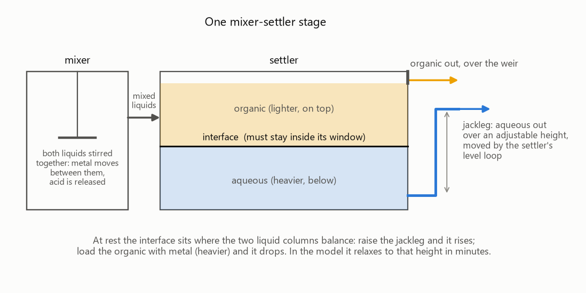

Each stage is a mixer and a settler. In the mixer the two liquids are
stirred together and metal moves between them, releasing acid. In the
settler they separate, the lighter organic on top. The organic leaves over a
weir; the aqueous leaves through a jackleg, a pipe whose height sets where
the interface sits. Load the organic with metal and it gets heavier, so the
interface drops. Interfaces have to stay in a window, or one phase goes out
with the other.

What the model keeps for every stage: the concentration of four components
(La+Ce, Pr, Nd, Sm and heavier) in each phase, the acid in the aqueous,
and the interface height. The chemistry is the one the industry uses on
the acid route: extracting one metal ion releases three protons, so acid is
tracked everywhere and saponification (pre-neutralizing the extractant) is
a handle. Sm and heavier are taken off upstream, as a plant does before
this circuit.

## 2. Where the numbers come from

| Source | What it gave |
| --- | --- |
| K. L. Lyon, MSc thesis, University of Idaho, 2016 | Nd and Pr extraction equilibria, fitted from their batch tables; stage size and residence time; the layout of extraction, scrub and strip |
| Rollat, Bertuol and Lévêque (Carester), COM 2024 | Feed compositions of six deposits, two of them monazites; the plain statement of what is hard: moving between feeds, flowmeter precision, interface drift |
| Yin et al., *Hydrometallurgy* 2018 | The industrial separation factor between praseodymium and cerium, which sets the lanthanum–cerium constant here |
| Yang et al., US patent 11,214,850 (2022), East China Jiaotong University ("ECJTU" in the figures) | A 60-stage plant circuit with two internal analysers and two flows as handles |

The one chosen number that carries the most weight: the lanthanum–cerium
extraction constant. Nd and Pr were fitted from measured tables; La+Ce is
set from a quoted industrial range (Pr over Ce, 1.8 to 2.2), using
cerium's value for the whole lump because cerium is the harder of the two
to keep out of the product. The others that matter: how close each stage
gets to equilibrium, the phase densities, and the noise, delay and sampling
of each instrument. All of them are in the parameter table with a label.
The stage one needs a word. The transfer rate is set from "three minutes
to equilibrium" in the thesis, which gives 95 % at the lab rig's flows. The
mixer here is the lab's scaled up 250 times, but the design runs more flow
through it than that scale allows for, so at the design flows a stage gets
about 81 to 85 % of the way to equilibrium. Section 5.4 sizes the mixer to
the flows as a side study.

## 3. How many stages

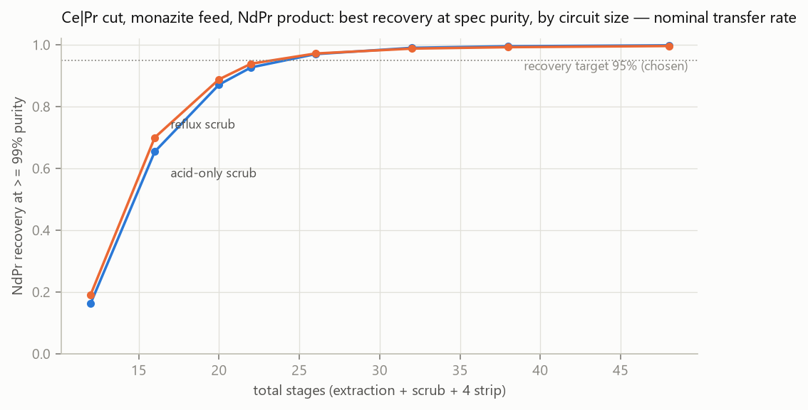

For each circuit size, an optimizer on the model found the best operating
point: the most NdPr recovered at 99 % purity, over organic flow, scrub
flow, scrub acidity and saponification, with the organic held at or below
85 % of its capacity in every stage (section 5.1 says why). Twelve stages
give 19 %, sixteen give 70 %, twenty give 89 %, twenty-two give 94 %,
twenty-six give 97 %, thirty-two give 99 %; 95 % recovery needs about 24.
With flows optimized, a reflux scrub (strip product sent back as scrub
liquor) beats an acid-only scrub by up to five points on the small
circuits, and the two meet by thirty stages.

For scale: the same sweep on the praseodymium–neodymium split, the one the
published circuits were built for, needs about seventy stages for 95 %
recovery with the same loading cap, and about 52 with the organic loaded as
full as the optimizer likes. That's section 8, where the model
was checked against two published circuits before this case was run.

How much of that is stage efficiency? Rerun with the transfer rate twenty
times higher, so a stage gets about 99 % of the way to equilibrium instead
of 81 to 85 %, and the same sweep gives 67 % at twelve stages, 93 % at sixteen, 97 %
at twenty, 99.7 % at thirty-two: 95 % recovery needs about eighteen stages
instead of twenty-four. The sizing answer is a bracket set by stage
efficiency, and measuring how close a real mixer gets to equilibrium is
worth more than any refinement of the chemistry. Mixers sized to the design
flows land near the good end of it: stages at 95 to 96 % and about nineteen
stages for 95 % recovery (section 5.4).

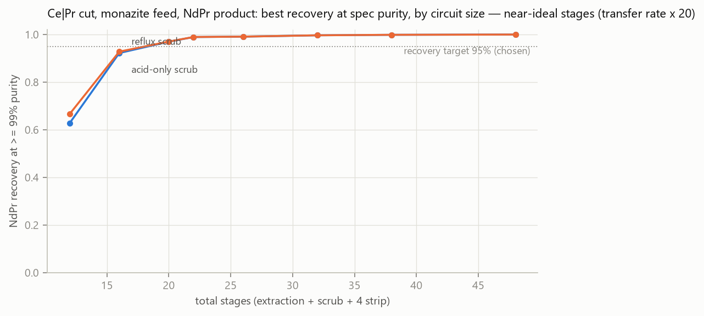

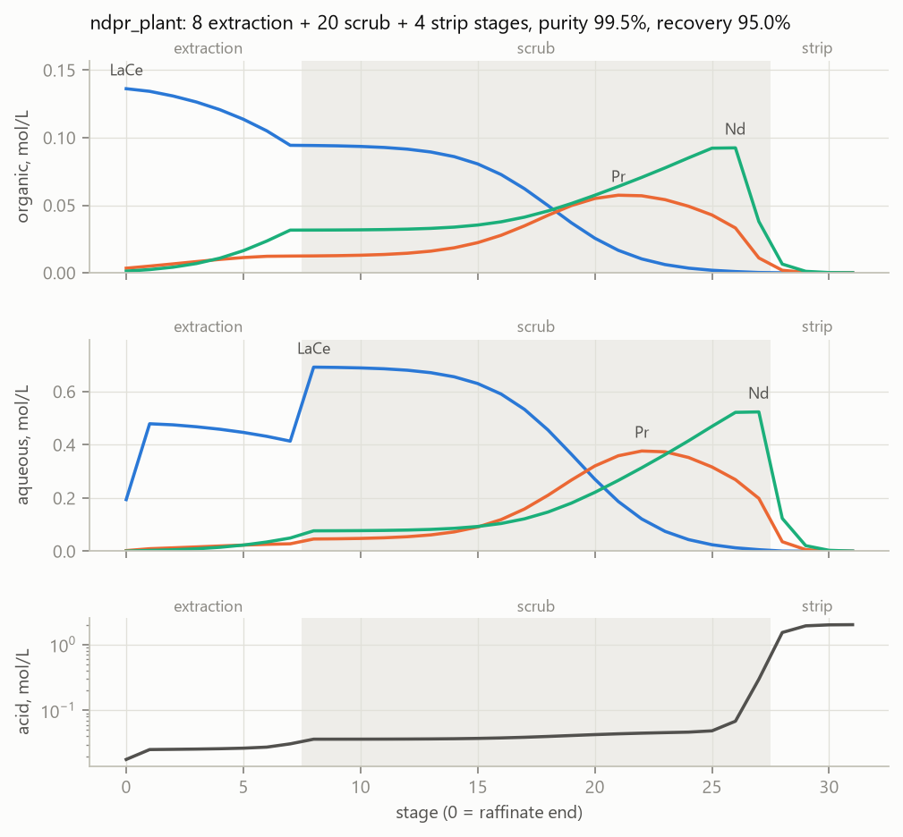

The 32-stage circuit at its designed point: 99.5 % NdPr in the product,
95 % recovery, found by minimizing reagent subject to those two floors and
the 85 % loading cap — 2,308 mol/h of caustic and acid, with 1,755 L/h of
organic against 600 L/h of feed. The extraction section runs at about pH 1.6 and the scrub
near pH 1.4, both with the organic at the 85 % loading cap, which is the
bound the optimizer sits on; the strip runs at 2 M. That is the model's point. The plant the
controller drives is not the model (section 5.1), and on it the same
handles give 96.9 % purity; the operating point every result below starts
from is the one the controller trims the real plant to: more scrub flow
(398 L/h against 239) at lower acidity (1.2 M against 2.0), a little less
organic, 2,717 mol/h of reagent.

## 4. What the upsets do

I ran eight upsets through the circuit with nobody touching anything, each
taken from the sources: a feed switch between two published deposits
(Eneabba to Yangibana, NdPr going from 21 % to 41 % of the metal), a 20 %
stronger feed, feed acid six times higher, the feed pump stopping for two
hours, an organic flowmeter reading 5 % low, a settler whose hydraulics
drift by 10 cm over five hours, scrub acid 50 % too strong, and two mixers
whose transfer rate drops to 30 %. All of it on the perturbed plant, from the trimmed
operating point.

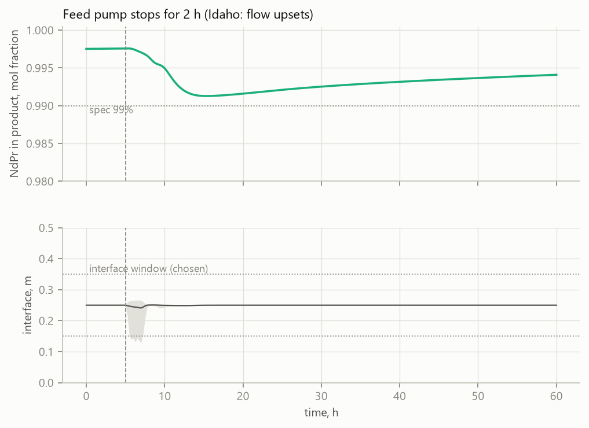

What they cost, over 60 hours, uncontrolled: the feed switch sends 1,800
mol of NdPr beyond the nominal 5 % out with the raffinate, the strong scrub
acid 1,280, the feed acid 850, the stronger feed 220. The flowmeter bias
takes purity down to 94.7 % and 1,880 mol of product off spec. The pump
stop takes purity to 99.1 % and one interface just out of its window for a
while. The hydraulic drift pushes one interface out of its window, about
18 metre-hours of it (how far out, times how long). The slow mixers do
almost nothing.

## 5. The controller

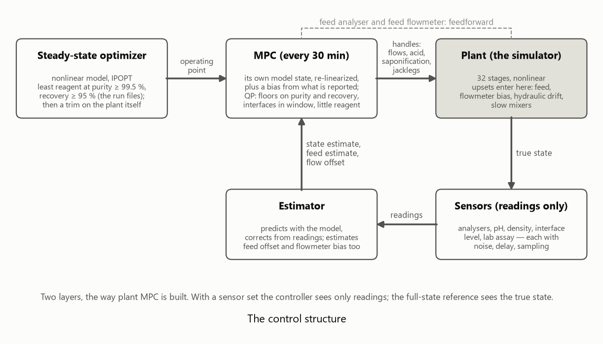

Two layers, the way plant MPC is built. The optimizer from section 3 sets
the operating point and the targets. A model predictive controller then
runs its own copy of the model, takes what the plant reports as a
correction on top of it (section 5.1 says why it is done that way),
linearizes the circuit's own equations on that model state every half
hour and solves a small quadratic program: keep purity and recovery above
their floors over the next twelve hours and at steady state, keep every
interface in its window and pull it back toward its setpoint, use as little
reagent as that allows, move the handles gently. The handles are organic
flow, scrub flow, scrub acidity, saponification, and the jackleg of every
settler. It solves in well under a second for this circuit, with OSQP, and
when OSQP fails the same problem goes to a second solver, qpOASES, before
the controller holds its handles (section 5.3 says why). The pull toward the
setpoint had a units slip that made it do nothing until 13 October; it was
fixed then, the second solver came in on 14 October, and every result in
this report is from the code after both.

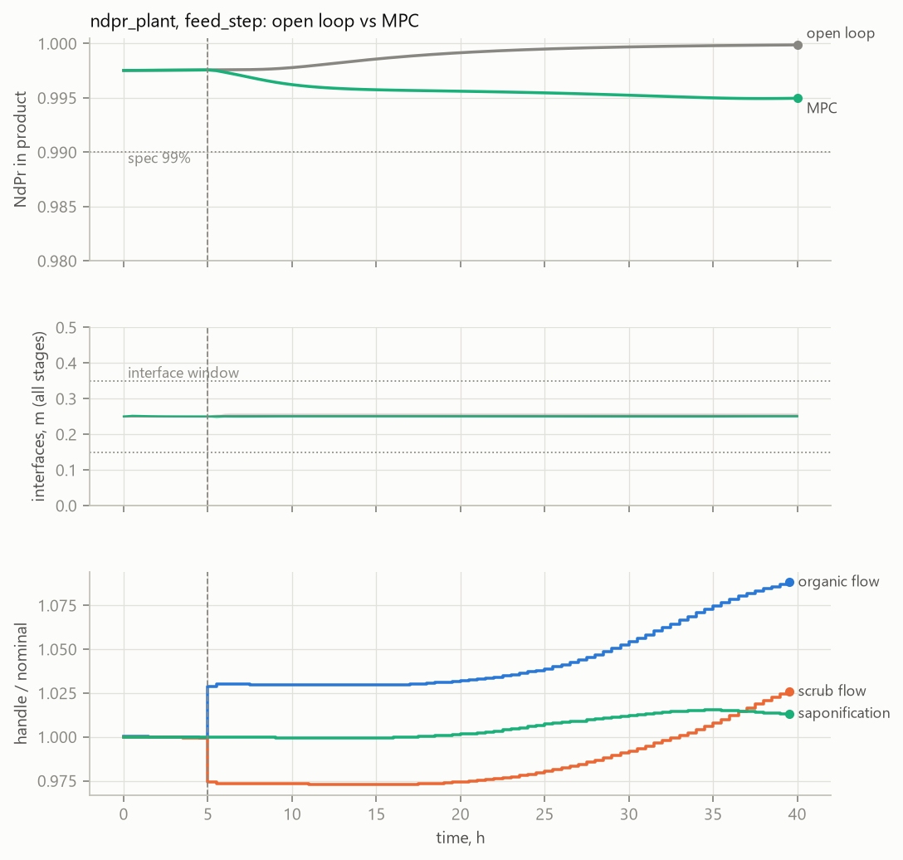

What the controller buys, in 40-hour runs on the perturbed plant (the
upset runs above were 60 hours, so their numbers are bigger), uncontrolled
against controlled. NdPr lost beyond nominal: feed switch 931
to 8 mol, strong scrub acid 600 to 0, feed acid 430 to 13, stronger feed
103 to 46. The flowmeter bias costs purity 97.7 % at worst and 800 mol of
off-spec product uncontrolled, 99.4 % and nothing off spec controlled. The
settler with drifting hydraulics: 11 metre-hours outside its window
uncontrolled, 0.00 controlled. Reagent moves by at most 6 % either way on
all eight, because the controller holds the floors and saves where it can.
Two upsets the controller does not improve. The slow mixers do almost
nothing to this circuit, so there is nothing to do. On the pump stop it
does about as well as doing nothing on this plant: purity dips to 99.3 %
against 99.1 % uncontrolled, nothing goes off spec either way, the
interfaces stay in, and it loses 27 mol of NdPr where the uncontrolled
circuit loses none.

But the pump stop is fragile. With the feed off and then back, the recovery
the controller is asked to hold reads nonsense for a while (product against
no feed, then product against a feed the circuit has not yet caught up
with), and the controller acts on it. Once the interface pull was fixed, I
swept its weight from 0 to 0.02 on six cases
(`notebooks/15_center_weight_sweep.py`). The feed switch, the drift and the
flowmeter bias came out about the same at every weight, the drift a little
better with the pull. The pump stop jumped around with no pattern. On the
entrainment plant the controller lost about 1,230 mol of NdPr at 0.0002 and
1,480 at 0.005, and at most 110 at the other weights; on the matched plant
it put 520 mol off spec at 0.005 and next to nothing at the others. Over
the twenty plants of section 5.3 it is better than doing nothing on 2 of
15 and worse on 5. Small numerical differences decide whether it rides
through or runs away. Two simpler fixes were tried on 8 October and each
made another upset worse (holding the handles while the feed is off; a
recovery read against the feed of a residence time ago).

What a plant does is an interlock. When the feed flow drops below a
threshold, the handles are frozen. When it comes back and settles, the
controller's bias and model state are reset from the plant before it gets
control back. That isn't built, and until it is, the pump stop is a limit
of this controller (section 10). It matters even though plants usually
have an installed spare feed pump: the feed can also stop upstream, at the
leach, the feed tank or a filter, for hours.

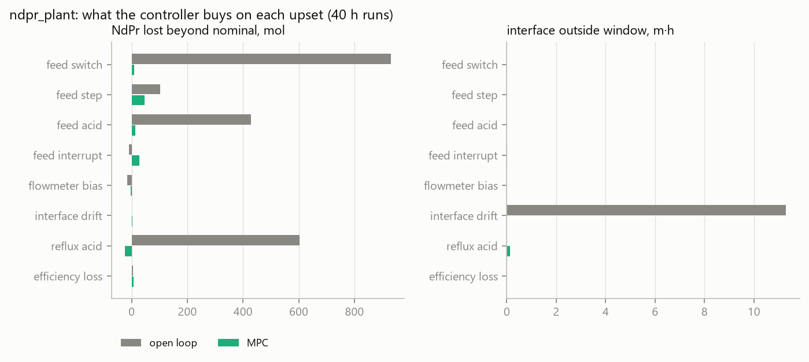

One result to read carefully. The feed switch doubles the NdPr in the feed
at the same total metal, which is a large upset. The controller recovers
nearly all of the NdPr the uncontrolled circuit was losing, and to do it lets
purity dip to 99.24 % for a few hours, still above the 99 % spec, with 0.5 %
less reagent; it ends on more organic and more scrub flow than it started
with, which is what the richer feed needs, at about half the scrub acidity.
The spec floor in the
controller is soft on purpose; whether a dip like that is acceptable is a
question of what a few hours of 99.2 % product cost against 931 mol of
NdPr, and the model can take the prices.

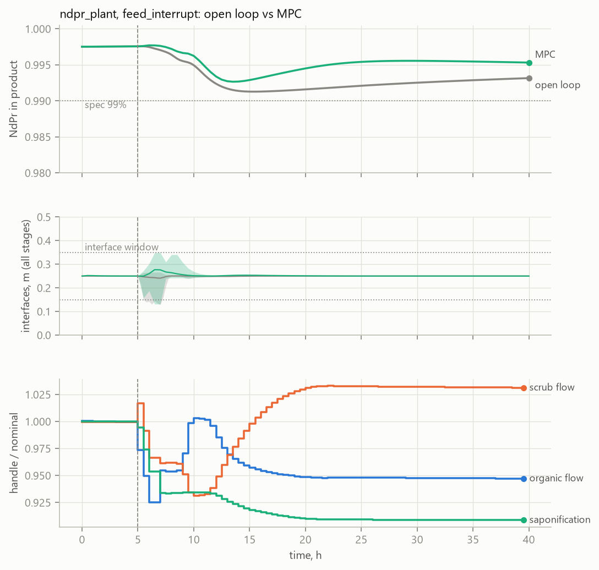

Four things did not work on the way, and each one changed the design.
The drifting settler was left alone at first: the controller's model had
the jackleg where it had been commanded, so it expected the interface to
fall back by itself. A hydraulic drift is a plant–model mismatch of the
same kind as a flowmeter bias, and the cure is the same: the controller
now infers the jackleg height each settler is really seeing from where its
interface sits, and plans with that. A nonlinear MPC took 90 seconds a
step on an 18-stage circuit. A linear
MPC fixed at the operating point sent its moves the wrong way on the
stronger feed, because the organic was near full and one linearization
does not cover that; re-linearizing every step fixed it. And the first
design sat at the organic pump's ceiling, so the controller had no room to
add organic when the feed got stronger; the design now leaves 15 % pump
headroom, which is what a plant does.

On the choice between this and a full nonlinear MPC: both would serve a
plant that acts every thirty minutes. The nonlinear one took 90 seconds a
step here, on an 18-stage circuit, and sometimes failed to converge; the
re-linearized one takes a fraction of a second and solves on nearly every
step (section 5.3 has the exceptions). The study needed
thousands of solves, so it got the second.

### 5.1 The plant is not the model

Everything above, as first run, had one flaw that made it look better than
it was: the plant the controller drove was the controller's own model,
upsets and sensors apart. A controller that knows the plant exactly will
always look good. So the plant is now built from a perturbed copy of the
parameters, drawn from a seed and documented (appendix B.8): extraction
constants off by a random factor with a 10 % spread (20 % for the chosen
La+Ce one), acid exponent 3.3 in the plant against 3.0 in the model, each
stage's transfer rate somewhere between 85 and 100 % of nominal, densities
and mixer hold-up off by a few percent. The controller, the estimator and the optimizer never see those
numbers. Every result in this report is on that plant, and section 5.3
runs the catalogue on twenty like it; the matched plant is kept as a
reference.

The first run on it was a failure worth keeping. On the handles the model
had designed for 99.5 % purity, the perturbed plant sat at 98.9 %. The
controller saw that, and over three hours cut organic, scrub and
saponification to a quarter of their values while purity fell to 96 %; it
lost 1042 mol of NdPr in 20 hours where the uncontrolled plant lost 156.
Three causes, each found by measurement:

- The design sat at the edge. Minimizing reagent, the optimizer had loaded
  the organic to 95–99 % of its capacity in every extraction and scrub
  stage. The distribution coefficient goes as the cube of the free
  extractant, so at that loading the model is so steep that a plant a few
  percent off it is outside what any linearization can describe. The design
  now keeps every stage at or below 85 % of capacity (chosen). It costs 2 %
  reagent.
- The controller linearized the model at the plant's state. A few percent
  away from the model's own steady states, the model's internal rates are
  large, and its linearization there is wrong in kind: the slowest mode 15 times too fast,
  the long-run purity gain per 100 L/h of organic +0.001 where the circuit's
  is −0.13, the recovery gain +1.6 where it is +0.03. The same linearization
  on the model's own trajectory matches the full model to four decimals. The controller
  now keeps its own model state, run forward with the model under the
  inputs it applied, and takes what the plant reports as an output bias
  added to every prediction. That is how industrial MPC has worked since
  DMC, and it is the integral action. Rate limits went down to a third of
  what they were.
- The horizon couldn't see the metal held up in the circuit. The slowest
  mode of this reflux circuit is about 400 hours. After a cut in scrub flow
  the product rate read 160 % of the feed for hours while that held-up
  metal drained; a 12-hour horizon saw recovery holding and the long run was a
  loss. The handles the plan ends on must now hold the floors at steady
  state as well, as far as the linear model knows.

Commissioning also changed. A plant is not run on the handles a model
designed; it is started on them and trimmed until the product is on spec.
So the controller now runs on the real plant, with full information, for
30 hours before any upset, and every scenario starts from the handles it
ends on. On the perturbed plant that trim takes purity from 96.9 % to
99.75 % with recovery held at 95 %, at 17 %
more reagent than the design (every run starts from 99.75 %). The plant's own optimum, found by the
optimizer when it is told the true parameters, is 1.4 % more; the
difference, about 16 % of the reagent bill, is what the model's error costs
on this plant, and a better model is what would buy it back. On the matched
plant the trim moves nothing (2308 to 2306 mol/h).

The matched plant is kept as the reference, and the same catalogue on it
says one more thing worth knowing. Started exactly at the model's design
point, with purity at 99.49 % and no margin over the 99.5 % target, the
same controller lets the feed switch dip to 98.95 %, 215 mol off spec, and
spends 15 % more reagent on it; the trimmed perturbed plant starts at
99.75 %, and the same upset stays on spec with 0.5 % less reagent. A quarter
of a point of purity above target is cheap insurance, which is how plants
run anyway.

### 5.2 Plants built differently from the model

A plant made from the model's own equations with other numbers still
follows the model's laws, so it only tests the tuning. Two more plants each
have a flaw real mixer-settlers have and the model leaves out (appendix
A.12). In the settler plant the metal only moves in the mixer, and the
liquid then flows through the settler as three tanks in a row; the model
lumps mixer and settler into one well-mixed pool. Same hold-up and same
steady state, different timing. In the entrainment plant each phase carries
droplets of the other into the next stage, where they come back with their
own phase, so some metal goes the wrong way: 500 ppm normally, rising to
2 % when an interface goes a few centimetres past its window. I chose those
two numbers; published figures for normal entrainment run from about 100 ppm
to the low thousands.

Four upsets, 40 hours, the controller seeing the full state, product off
spec in mol:

| Plant | Controller | Feed switch | Pump stop | Flowmeter bias | Interface drift |
| --- | --- | --- | --- | --- | --- |
| matched | MPC | 215 | 0 | 0 | 0 |
| perturbed | MPC | 0 | 0 | 0 | 0 |
| settler | MPC | 0 | 0 | 0 | 0 |
| entrainment | MPC | 215 | 0 | 0 | 0 |
| matched | MPC fixed at one point | 4,833 | 1,650 | 1,332 | 0 |
| settler | MPC fixed at one point | 4,747 | 1,879 | 1,332 | 0 |
| entrainment | MPC fixed at one point | 4,721 | 1,797 | 1,360 | 0 |

The controller as built holds both new plants on all four upsets as well as
it holds the matched one. On the pump stop it puts nothing off spec on any
of the four plants and loses at most 27 mol of NdPr; that's one weight and
one draw of each plant, and section 5 showed how much the pump stop moves
with either. The linear MPC fixed at one operating point, with no output
bias, does badly on every plant, the matched one included: 4,721 to 4,833
mol off spec on a feed switch. Off spec counts against the 99 % line,
so 0 against 215 between two similar runs is a small difference in purity,
not a large one. Next on this line: entrainment at upset levels, the new
plants with the perturbed numbers on top, and the same matrix with real
sensor sets.

### 5.3 Twenty plants, not one

**Correction (October 15 to 17).** This section is the first version of the
study, and its reading of the five hard plants was wrong twice. Those five
weren't hard plants: the generator that drew them put their separation factors
outside the published ranges (Pr/La+Ce about 1.0, or Nd extracting less than
Pr), and no setting of the handles can make spec on them (notebook 17). And the
"fifteen times" gain below compared the model and the plant at different
operating points. With plants drawn inside the published ranges (notebook 14,
generator "ratios"), the plants that are hard are the ones that separate a
little worse than the model, and what made them hard was the small mixers and a
missing acidity floor in the controller (notebooks 21 and 26,
`FINDINGS_why_hard.md`). The current study, on the main case, is in
`README.md`. The text below is kept as the record of the first version, and its
numbers still match their table (`runs/history/seed_spread_ndpr_plant_v1.csv`).

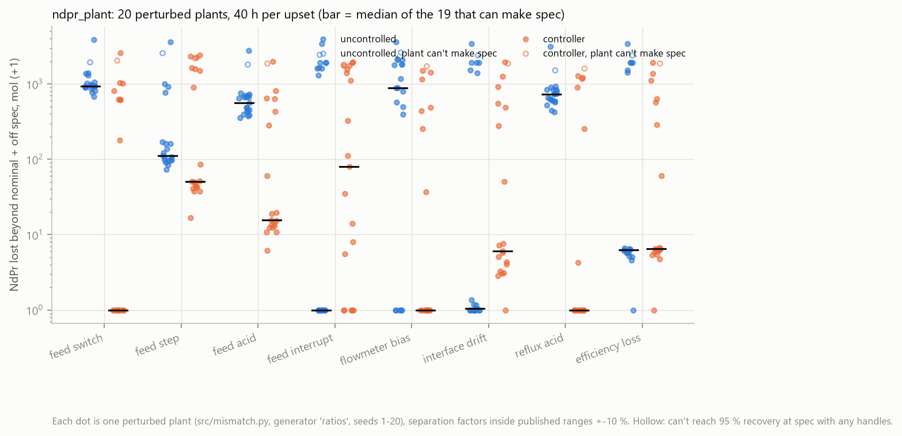

Everything so far is on one perturbed plant, drawn from seed 1. A result
that only holds on that one draw isn't worth much. So I drew twenty plants
the same way (seeds 1 to 20; seed 1 is the plant above), commissioned and
trimmed each one the same way, and ran all eight upsets on each,
uncontrolled and under the controller, 40 hours, full state
(`notebooks/14_seed_spread.py`). The score per run is NdPr lost beyond
nominal plus product made off spec, in mol.

Five of the twenty (seeds 3, 6, 13, 14 and 17) can't make 95 % recovery at
99.5 % purity with any setting of the handles. Their best, from the design
optimizer told their true numbers, is 72 to 92 %. On those the controller is
asked for something that can't be done. The commissioning trim ends far
below spec (seed 3 at 49 % purity), and all five sit below spec for every
run that follows. The controller still does a good deal better than doing
nothing there: on every upset it cuts the score by a quarter to a half
(medians 2,490 to 3,570 mol uncontrolled, 1,560 to 2,700 controlled), and
it's better on 4 or 5 of the 5 each time. What it doesn't do is bring
purity to spec within the 40 hours. Two things are behind that.

The first was the solver. On plants that far off spec the slack costs run
into the millions, and OSQP often reported the QP as infeasible. That's a
false alarm: every output constraint has a slack, so the QP always has a
solution. But on a failed solve the controller holds its handles, so on
those plants it was mostly frozen; on seed 3 every step of every run
failed. OSQP also wasn't repeatable there, because by default it retunes
its step size on a schedule set by how long its own setup took. Both are
fixed (ARCHITECTURE.md decision 30): the schedule is now a fixed interval,
and when OSQP fails, the same QP goes to qpOASES, an active-set solver,
before the handles are held. Every closed-loop result in this report was
rerun with that. Now 401 of the 3,200 steps on the five plants fail, 298 of
them on seed 17, where both solvers still fail on most steps of four
upsets.

The second is the model. On those plants it badly underestimates what the
scrub flow does to purity. On seed 3, 10 L/h more scrub flow, run out long,
moves purity by +4.6 thousandths and recovery by −9.7 points in the model,
and by +64 thousandths and −1.5 points on the plant. The sign is right for
every handle; only the size is wrong, about fifteen times on purity. So the
controller moves the right way, but too timidly. The answer to that is
correcting the model's gains from the plant's own data, the adaptive
step up from what's built here, and it isn't built (section 10).

The first write-up of this study read it differently: that the controller
gave up purity for recovery because both are soft floors with fixed weights
and nothing ranks the spec first. Industrial MPC handles that with
prioritized constraints, so I built them two ways and tried them on two plants that can
make spec (seeds 1 and 2, through a feed switch) and two that can't (seeds
3 and 13, no upset), each version also doing the commissioning trim
(`notebooks/16_ranked_constraints.py`). One is a two-stage QP: the first
finds the smallest shortfall below spec the handles can reach, and the
second may not go below that. The other is one QP with a straight-line cost
on falling below spec on top of the squared one, at 1,000 and at 100 per
thousandth. Neither is a fix. The two-stage form made the plants that can
make spec worse: seed 1's trim ended at 99.48 %, short of the 99.5 %
target, and on the feed switch seed 2 fell to 62 % purity with 4,592 mol
off spec, against 98.3 % and 536 mol without it. On the hard plants it
helped seed 13 (98.0 % purity at the end against 89.0 %) and hurt seed 3
(85 % against 96 %). The straight-line cost changed little on seeds 1 and 2
and gave mixed results on 3 and 13. No version brought a hard plant to
spec in 40 hours. Both are kept in the code as settings, off.

On the fifteen plants that can make both targets:

| Upset | Uncontrolled, median (mol) | Controller, median (mol) | Controller, worst (mol) | Controller better on |
| --- | --- | --- | --- | --- |
| feed switch | 931 | 0 | 558 | 15 of 15 |
| feed acid | 452 | 13 | 62 | 15 of 15 |
| stronger feed | 101 | 38 | 1,025 | 14 of 15 |
| strong scrub acid | 655 | 0 | 1,233 | 14 of 15 |
| flowmeter bias | 612 | 0 | 33 | 8 of 15 |
| pump stop | 0 | 0 | 1,703 | 2 of 15 |
| interface drift | 0 | 4 | 52 | 0 of 15 |
| slow mixers | 4 | 5 | 62 | 0 of 15 |

The feed switch and the feed acid hold on every plant. The stronger feed
and the strong scrub acid hold on 14 of 15, with one bad run each. On the
flowmeter bias the uncontrolled plant puts nothing off spec on 7 of the 15,
and the controller is better on all the other 8. On the drift the
controller keeps every interface in on all 15 (none out, against 8 to 12
metre-hours uncontrolled) for a few mol of NdPr; this score doesn't count
interfaces. The slow mixers do almost nothing on any plant. The pump stop is
section 5's fragile result again: better on 2 of 15, worse on 5, up to
1,703 mol. So the catalogue's results now rest on fifteen plants, not one.
The sensor study, the structural plants and the learned policy are still on
seed 1.

### 5.4 Stages sized to the flows

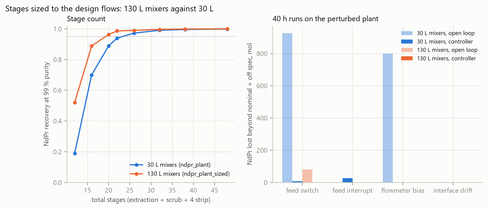

The mixer here is the lab rig's scaled 250 times: 30 L, which keeps the
lab's three minutes at 600 L/h. The design puts up to 2,594 L/h through an
extraction mixer, so the stages get 81 to 85 % of the way to equilibrium
(section 2). As a side study I sized the stages to the design flows: 130 L
mixers, which keeps three minutes at the largest flow, and 520 L settlers,
four times the mixer as on the lab rig. The design, the stage sweep and the
controller were then run on that plant (`notebooks/13_stage_sizing.py`).

- Stages get 95 to 96 % of the way to equilibrium.
- 95 % recovery needs about 19 stages instead of 24, close to the 18 of
  near-ideal stages. At 32 stages the best recovery at 99 % purity is 99.6 %
  against 99.0 %.
- The redesigned 32-stage point needs less organic (1,634 L/h against
  1,755) and less reagent (2,172 mol/h against 2,308). It still sits on the
  85 % loading cap. The flows don't go back up, because loading is set by
  the mass balance; tank size only sets contact time.
- The plant is much more linear over one controller move. Twelve hours
  after a step of one rate limit, compared with a step four times bigger
  divided by four, purity differs by 8 to 24 % across the four handles,
  against 25 to 111 % on the 30 L plant. It also moves less per move.
- It's about 3.5 times slower: the slowest time constant is 1,381 hours
  against 393. So a 40-hour run sees less of each upset. Uncontrolled, the
  feed switch loses 80 mol in 40 hours and 2,678 in 120; under the
  controller, about zero either way.
- On the bigger plant the pump stop puts nothing off spec under the
  controller, and the flowmeter bias puts nothing off spec even
  uncontrolled.

The main case stays the 30 L plant; this is a side study. A run file can
now carry its own edits to the parameter file, which is how the sized plant
gets its own run file (`configs/ndpr_plant_sized.toml`).

## 6. Sensors and handles

Everything above was done with a controller that could see the whole
circuit. Real controllers see readings. I gave the model sensors, each
with a location, a noise, a delay and a sample interval: on-stream
analysers, pH probes, density meters, interface level, a lab assay every
two hours that comes back four hours later. An estimator fills in the
rest from the model, and it carries a few extra states, offsets on the
feed composition and on the organic flow, so that a flowmeter bias shows
up as a number the controller can act on. What an analyser on the product
stream reads, the controller uses as read; the estimate stands in only for
what no instrument reads.

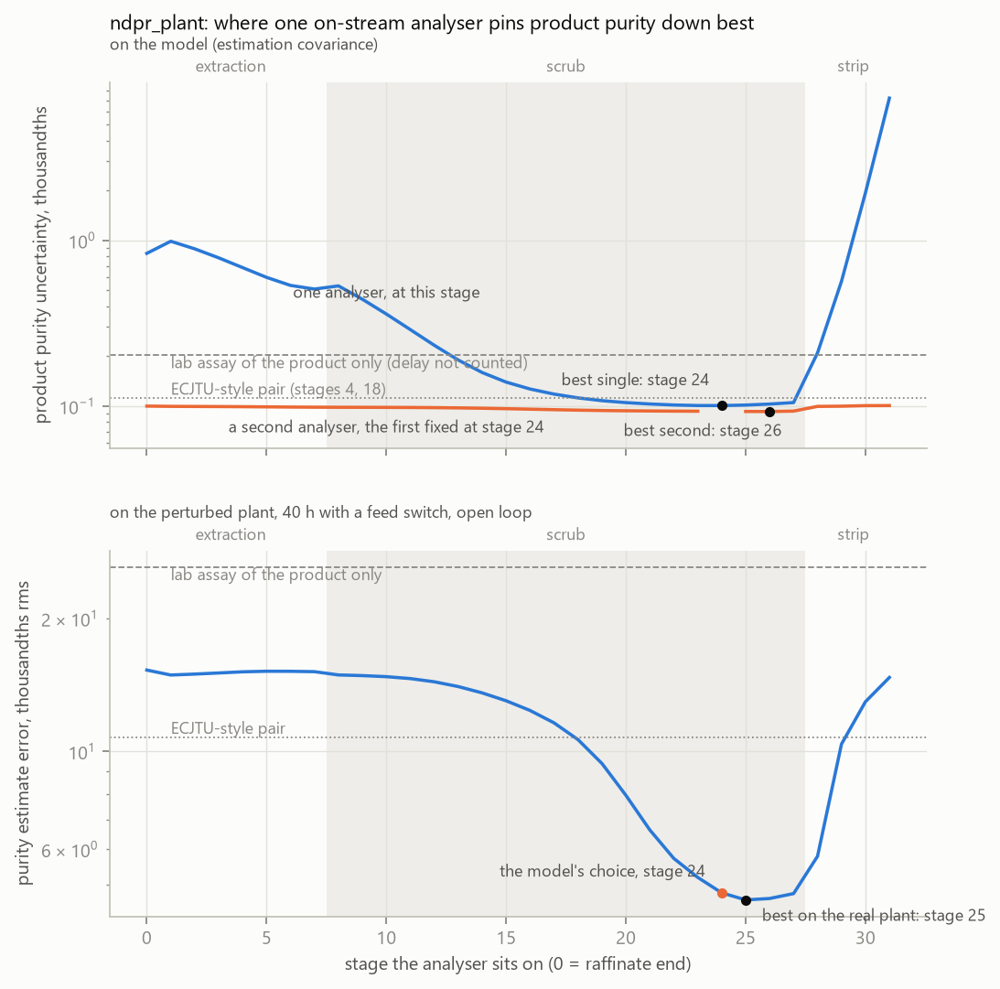

Before any controller runs, the model can say where an analyser should go.
Trusting the model, one analyser reading the aqueous at stage 24, late in
the scrub section, pins product purity to a tenth of a thousandth. A second
analyser improves that by 8 %. The patent's layout, one in extraction and
one in scrub, is 11 % worse than the best single analyser. A lab assay of
the product alone is twice as bad on this metric, which counts precision
and sampling but not its four-hour delay.

The bottom panel asks the same question on the perturbed plant, with the
numbers forty times larger. There, the estimator's purity, fed by one
analyser, is off by about five thousandths rms anywhere from stage 23 to
the product stream (best at stage 25 with 4.6, the model's choice at 24
with 4.8, the product stream itself 5.8), fifteen thousandths from an
analyser in the extraction section, 10.8 with the patent's pair, and 26
with the lab assay alone. The shape of the curve is the same on both
plants; what the real plant adds is a floor of a few thousandths that no
placement gets under, which is the model's error showing through. That is
why the controller treats a measured product as measured (appendix B.2): an
analyser on the product stream gives it purity to the instrument's
precision, and the estimator only has to fill in what no instrument reads.

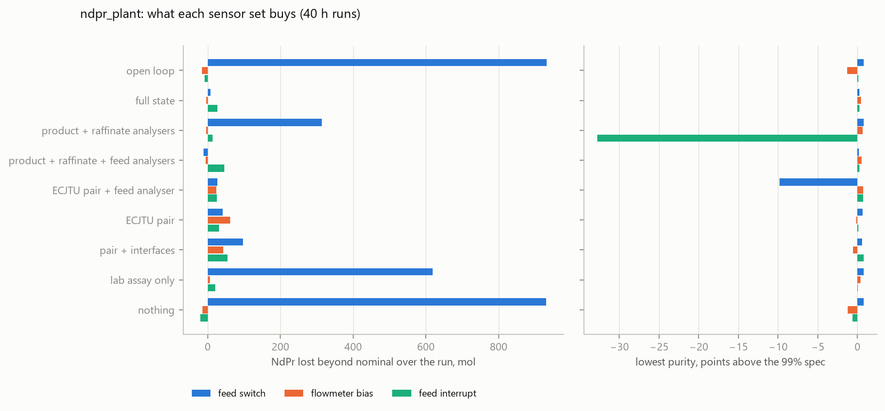

Then the controller ran with each sensor set in turn, on the perturbed
plant, through three upsets: the feed switch, the flowmeter bias and the
pump stop. The same controller, the same estimator, only the readings
change. What came out, by upset.

The feed switch is about seeing the feed. With a feed analyser the
controller loses nothing beyond nominal (product, raffinate and feed
analysers: −11 mol against 931 uncontrolled). The patent's two mid-cascade
analysers see the switch arriving through the cascade and do nearly as
well without a feed analyser (41 mol), and with one they overreact badly:
26 mol lost and 2,300 mol off spec, purity down to 89.2 %, because the
feedforward is acted on through a model that is a few percent wrong. Analysers on the
product and raffinate without a feed analyser see the switch late, 310
mol. A lab assay alone, every two hours and four hours late, loses 620;
the controller with no readings at all, 930, the same as doing nothing.

The flowmeter bias is about seeing the product end. Uncontrolled, purity
falls to 97.7 % and about 800 mol go off spec. The mid-cascade pair alone
lets purity fall to 98.8 % with 290 mol off spec, and with interface
readings added, to 98.4 % with 320 mol. Every other set with one instrument
of any kind holds purity above 99.3 % and nothing off spec; the lab assay
alone does it too. A controller with no readings does no better than none.

The pump stop is where this controller is weakest, and section 5 showed
that its result swings with small changes, so each number below is one
draw, not a ranking. Uncontrolled, the circuit stays within a point of spec
and no interface leaves its window. With the full state the controller
puts nothing off spec either (section 5). So do five of the six sensor
sets that read anything, losing 20 to 55 mol of NdPr; the lab assay alone
is one of them. Product and raffinate analysers without a feed analyser run
away: purity down to 66 % with 1,720 mol off spec and interfaces out for
about five metre-hours. No readings at all puts 1,360 mol off spec.

Product, raffinate and feed analysers do well on all three upsets, which is
what the recommendation in section 9 rests on. The sets built on the
mid-cascade pair each do badly somewhere: alone and with interface
readings, on the flowmeter bias; with a feed analyser, on the feed switch.
With interface readings the feed switch puts nothing off spec, but the
interfaces spend about five metre-hours outside their window and 20 of the
80 solves fail.

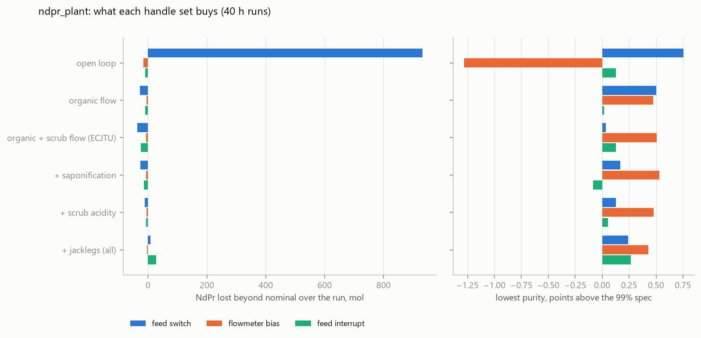

The handles, with the full state. On the feed switch, organic flow alone
holds recovery at 8 % more reagent; organic and scrub flow together, the
patent's two, at 18 %; add saponification and it drops to 10 %, with two
failed solves on the way; add scrub acidity, 5 %; add the jacklegs, which
is the full set of section 5, and it uses 0.5 % less reagent than doing
nothing. Past the patent's two, each handle added makes the feed switch
cheaper. On the flowmeter bias any handle set does. On the pump stop
organic flow alone holds purity at 99.0 % with nothing off spec, and so do
organic and scrub flow together; add saponification and 220 mol go off
spec, add scrub acidity 0, the full set 0.

## 7. A learned policy, for comparison

The upsets that matter most here are the ones a plant handles by hand:
moving from one feed to another, settling after a change. That is where a
learned policy could earn its place, so I trained one, as a comparison and
not as a proposal: PPO, one hour of training on the 16-stage perturbed
circuit, the same four handles as the controller, the same analysers on the
product, raffinate and feed and the same interface sensors. Each episode
draws its upsets: a feed switch at a random time in about half of them (in
the other half the feed "switches" to the one it already is), a flowmeter
bias in most and a slow mixer in half. Then five identical episodes, the
policy against the controller, scored the same way. Episode 1 is one with
no feed switch, only a flowmeter bias.

| Episode | Lowest purity, policy | Lowest purity, controller | NdPr lost beyond nominal, policy (mol) | Controller (mol) | Reagent, policy (mol) | Controller (mol) |
| --- | --- | --- | --- | --- | --- | --- |
| 1 | 99.50 % | 99.46 % | 697 | -8 | 65,800 | 88,400 |
| 2 | 99.37 % | 99.36 % | 1,618 | 430 | 66,900 | 86,700 |
| 3 | 99.50 % | 99.38 % | 1,931 | 517 | 66,200 | 85,600 |
| 4 | 99.50 % | 99.39 % | 2,058 | 531 | 70,500 | 84,900 |
| 5 | 99.50 % | 99.40 % | 2,136 | 547 | 67,300 | 84,300 |

After an hour the policy holds purity on all five episodes, with nothing
off spec. It lets the interfaces stray a little (at most 0.14 metre-hours
outside the window) where the controller keeps them in, uses a fifth less
reagent, and on the four episodes with a feed switch loses about four
times more NdPr. It has learned the easy part of the job, to keep the
reagent down and the product clean, and not yet the part that pays, to
move the organic and the scrub to hold the metal. Even with no feed
switch, in episode 1, it loses 697 mol where the controller loses none
(−8).
Nothing in that is a property of the circuit; it is one hour of training
on a reward that prices metal a hundred times above reagent, and more hours with
the same reward would move it. What the comparison is for: the simulator
is the one place such a policy can be trained without losing a tonne of
product to find out, and the controller is the bar it has to clear.

## 8. Checking the model where there is something to check it against

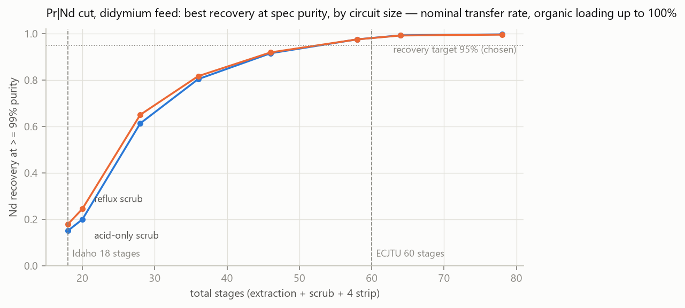

The published circuits in the sources were built for the harder split,
praseodymium from neodymium, with a separation factor of 1.5 per stage.
Before running the NdPr case I ran the model on that split, with the
didymium feed those circuits take, and with the optimizer free to load the
organic as full as it liked, which is how it was first built. Both
published circuits land on the model's curve: the Idaho rig with 18 stages
(99.7 % purity, low recovery, as they reported), and the 60-stage plant in
the patent at 99 % recovery — the model gives 97.5 % at 58 stages and
99.3 % at 64.

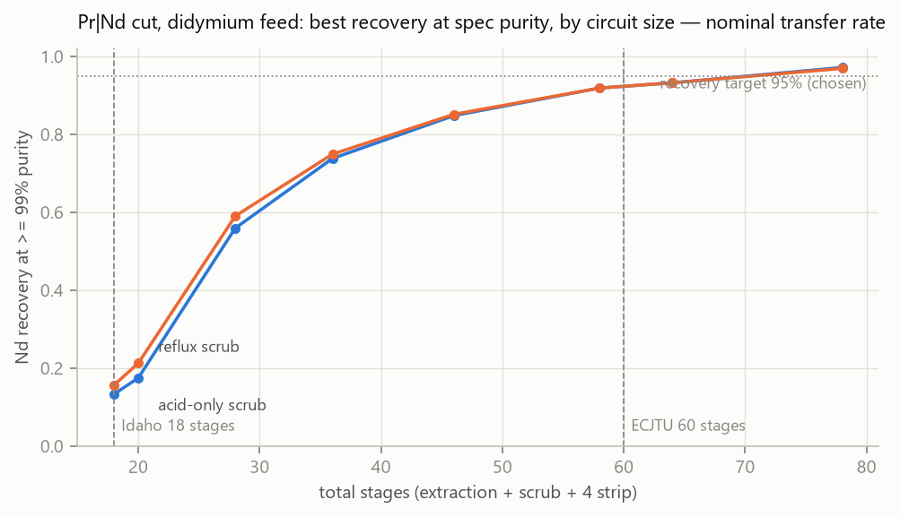

With the 85 % loading cap that the NdPr design now carries (section 5.1),
the same sweep moves: 92 % at 58 stages, 93 % at 64, 97 % at 78, and 95 %
recovery needs about seventy stages. The published plant either runs its
organic fuller than my design rule allows, or has better stages than mine.
Mine aren't good at those flows: the Pr/Nd plant design puts so much flow
through each mixer that a stage gets only about 70 % of the way to
equilibrium, against the 95 % the transfer rate gives at the lab's flows.
Both are plausible, and I can't tell which from the patent. What stays true either way: on this split the sizing answer moves
by ten to twenty stages with stage efficiency and with how full the organic
runs, and those two numbers are worth measuring on a real stage before
trusting any curve.

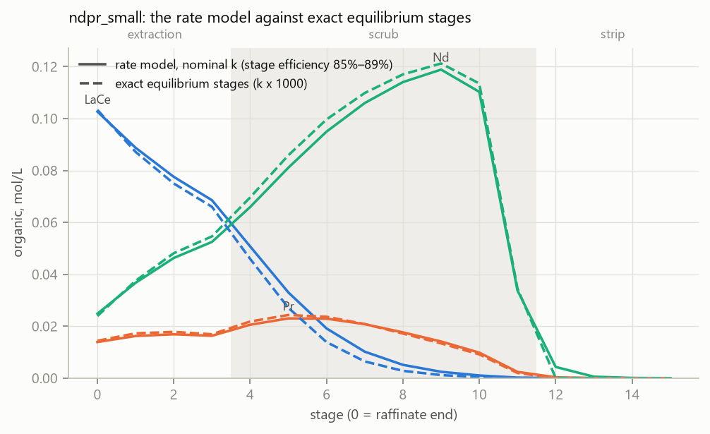

One more check, of the stage model against itself. The stages here are
rate-based: metal moves at a finite rate toward equilibrium, and the
transfer constant was set so a stage gets 95 % of the way there in the
thesis rig's residence time (on this circuit's flows, 85 to 89 %). Pushing that constant a thousand times higher
turns every stage into an exact equilibrium stage, which is the textbook
model. On the 16-stage circuit the two profiles nearly coincide, and the
product differs by about four thousandths of purity. The difference shows up in
what the optimizer can do with the stages: with exact ones the same
circuit's best recovery at 99.5 % purity goes from 58 % to 91 %. The
textbook model would size this plant a third smaller than the rate model
does, and which one is right is, again, a question of how good the real
mixers are.

## 9. What I would say about all this on a plant floor

- The stage count depends on stage efficiency and on how full the organic
  runs more than on anything else I varied. Measuring both on a real stage
  is worth more than any model refinement. Mixers sized to the flows took
  95 % recovery from 24 stages to about 19 here.
- A controller that knows the plant exactly always looks good. Build the
  plant you test on from different numbers than the model plans on, and
  watch what breaks. What broke here was the controller, three ways.
- Test on more than one such plant. Of twenty draws, five couldn't make
  spec at all; on the other fifteen the catalogue's results mostly held.
- Linearize the model on its own trajectory and let the plant in as a
  correction. Linearizing at the plant's state looks more accurate and is
  wrong in kind.
- A reflux circuit's inventory settles over days. A controller that only
  looks twelve hours ahead will borrow from it; the handles it ends on have
  to hold the floors at steady state as well.
- Measure what you control: an analyser on the product and one on the
  raffinate, a feed analyser and a feed flowmeter for feedforward, the
  scrub liquor's acidity read back. Analysers mid-cascade are what you add
  once the model has earned trust, not before. A lab assay alone is not a
  control instrument.
- Pump headroom and loading margin are control decisions, not just design
  ones.
- On a pump stop this controller's result swings from plant to plant and
  with small changes in tuning. A plant interlocks it: freeze the handles
  when the feed flow drops, and when it's back and steady, reset the
  controller from the plant before it takes over again.
- Count the solver's failures. A QP with a slack on every output limit
  always has a solution, but the solver here still called it infeasible on
  plants far off spec, and the controller held still. A second solver for
  the same problem fixed most of it.
- On a plant far from the model the gains are wrong in size even when
  they're right in sign, and the controller moves too timidly. Ranking the
  spec first didn't help here. Correcting the gains from plant data is the
  next step.
- The controller holds recovery at any reagent cost. Prices turn that into
  a decision; the model can take them.

## 10. Limits

- The interface has no top or bottom in the model. In the uncontrolled drift
  run it climbs to 0.71 m, above the 0.45 m organic weir, where a real settler
  would already be sending aqueous over the weir.
- The interface model is one-way: loading moves the densities, densities
  move the interface, and the interface does not change the hold-ups.
- Saponification is an equivalent base dose carried with the organic, not
  a tracked sodium form.
- The lanthanum–cerium constant is chosen from an industrial range, not
  fitted; the densities, the heavy-element constant, the instrument noise
  and delays are chosen too.
- The plant the controller drives differs from the model by amounts I
  chose (constants with a 10–20 % spread, acid exponent +0.3, stage transfer
  rates 85–100 %, densities and hold-up a few percent). Two more plants add
  mechanisms the model lacks, settlers the liquid flows through and
  entrainment (section 5.2), as a first pass. A real plant may be off in
  other ways still: crud, third phase, hydraulics that depend on throughput.
  The upset catalogue is run on twenty draws of the perturbed plant
  (section 5.3); the sensor study, the structural plants and the learned
  policy are on one, seed 1.
- The mixer is scaled from the lab rig for 600 L/h, and the designs run more
  flow than that through it, so the stages get 70 to 89 % of the way to
  equilibrium depending on the circuit and section. Sized to the design
  flows (section 5.4), the NdPr plant's stages get 95 to 96 % and 95 %
  recovery needs about 19 stages; the main case keeps the 30 L mixer, and
  the Pr | Nd plant hasn't been resized.
- The pump stop is fragile: small differences decide whether the controller
  rides through it or runs away (section 5). A plant would put an interlock
  around it, freezing the handles while the feed is off and resetting the
  controller from the plant when it's back. That isn't built.
- The controller plans on the model's gains. On the five seeded plants that
  can't make both targets those gains are badly off in size (about fifteen
  times on purity per unit of scrub flow on seed 3), so the controller moves
  too timidly and none of them reaches spec within a run (section 5.3).
  Ranking the spec first was tried and didn't fix it. Adapting the model's
  gains from plant data is the next step; it isn't built. On seed 17 both
  solvers still fail on most steps of four upsets.
- The estimator's feed offsets are capped at ±50 % of nominal and its flow
  offset at ±15 %, so without a feed analyser it cannot learn a feed whose
  NdPr has doubled; the study shows what that costs.
- The 85 % loading cap is chosen. With it, the model needs more stages for
  the Pr | Nd split than the published 60-stage plant reports; without it,
  the published circuits sit on the model's curve (section 8). Which of the
  two is nearer a real plant is a question for a real plant.

## 11. What is in the repository

The code (Python; CasADi and IPOPT for the model and the optimizer, OSQP
for the controller's QP with qpOASES as a backup), one file with every parameter and its source, the
run files that produced every figure, the tests, a build log with what
went wrong and what it changed, and the two appendices. Also a workbench
(`pixi run workbench`): pick a plant, a controller, an upset and a sensor
set, edit any setting, and watch the circuit run, with every panel able to
float on its own monitor. The same runs go through a command line
(`python -m src.cli`), which can run a whole matrix of them. README.md has
the commands.
